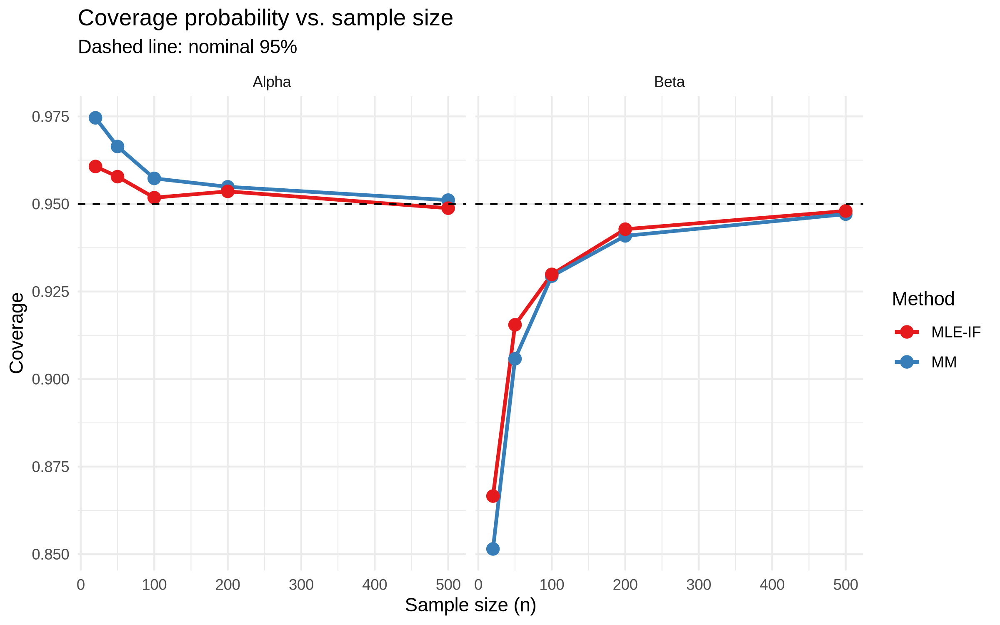
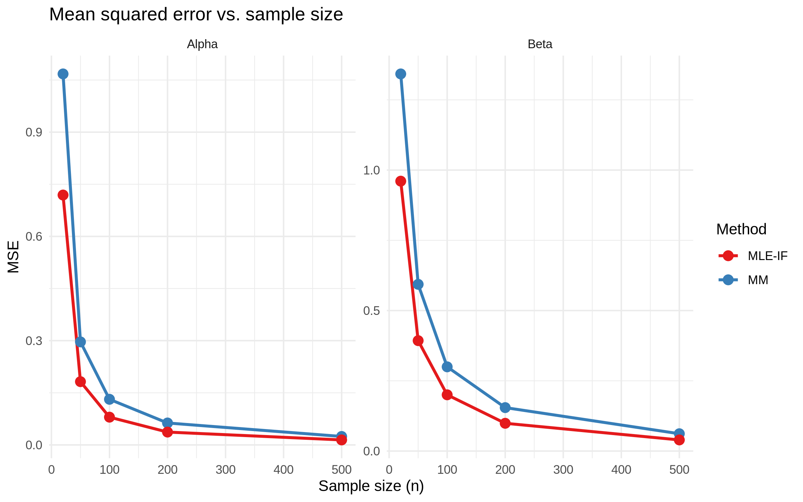

# Gamma Distribution Estimators: A Monte Carlo Study


**How well do maximum likelihood and method-of-moments estimators hold up in finite samples?** This simulation compares them for the Gamma distribution across five sample sizes. Along the way, it exposed and corrected an error in the method-of-moments covariance matrix given in the course assignment.

## Key findings

- **Maximum likelihood is more efficient.** Its mean squared error is lower at every sample size, with method-of-moments MSE about 1.4 to 1.7 times higher.
- **The assignment's covariance matrix understated uncertainty.** Corrected standard errors match the simulated spread of the estimates, and coverage at n = 500 rises from 0.896 to 0.951 for the shape and from 0.860 to 0.947 for the scale.
- **Small samples remain a problem for the scale parameter.** At n = 20, coverage for β is only 0.852 (method of moments) and 0.867 (maximum likelihood), even after the correction.



## Study design

| Item | Value |
|---|---|
| True distribution | Gamma(α₀ = 2, β₀ = 3), shape-scale parameterization |
| Sample sizes | 20, 50, 100, 200, 500 |
| Replications | 10,000 per sample size, seed 42 |
| Intervals | 95% Wald, with each tail's error recorded separately |
| Metrics | Bias, MSE, standard deviation, mean standard error, interval width, coverage |

| Method | Estimation | Standard errors |
|---|---|---|
| Method of moments (MM) | Closed form | Delta method |
| MLE-IF | Newton-Raphson on the log scale, started at the MM estimate | Expected Fisher information |
| MLE-IO | Same estimates as MLE-IF | Observed information |

## The covariance correction

The assignment gives one covariance matrix for the MM estimators, but applying the delta method to the sample mean and variance gives another:

| Term | Assignment | Delta method (used here) |
|---|---|---|
| Var(α̂) | α(2 + α) | 2α(α + 1) |
| Var(β̂) | β²(2 + α) / α | β²(2α + 3) / α |
| Cov(α̂, β̂) | β(2 + α) | −2β(α + 1) |

The simulation supports the correction, because the corrected standard errors match the observed spread of the estimates at n = 500:

| Estimator | Observed SD | Mean SE, assignment | Mean SE, corrected |
|---|---:|---:|---:|
| α̂ (MM) | 0.155 | 0.127 | 0.156 |
| β̂ (MM) | 0.248 | 0.189 | 0.251 |

The full derivation is in the [report](report/gamma_simulation_report.pdf). The correction changes only MM standard errors, interval widths, and coverage. Estimates, bias, and MSE are unchanged because the seed is the same.

## Results

### Coverage of 95% intervals

| n | α: MM, assignment | α: MM, corrected | α: MLE | β: MM, assignment | β: MM, corrected | β: MLE |
|---:|---:|---:|---:|---:|---:|---:|
| 20 | 0.929 | 0.975 | 0.961 | 0.779 | 0.852 | 0.867 |
| 50 | 0.909 | 0.966 | 0.958 | 0.831 | 0.906 | 0.915 |
| 100 | 0.903 | 0.957 | 0.952 | 0.853 | 0.929 | 0.930 |
| 200 | 0.899 | 0.955 | 0.954 | 0.854 | 0.941 | 0.943 |
| 500 | 0.896 | 0.951 | 0.949 | 0.860 | 0.947 | 0.948 |

### Efficiency

| n | α: MM MSE | α: MLE MSE | α: ratio | β: MM MSE | β: MLE MSE | β: ratio |
|---:|---:|---:|---:|---:|---:|---:|
| 20 | 1.068 | 0.719 | 1.48 | 1.342 | 0.961 | 1.40 |
| 50 | 0.296 | 0.182 | 1.63 | 0.593 | 0.393 | 1.51 |
| 100 | 0.131 | 0.080 | 1.64 | 0.300 | 0.200 | 1.50 |
| 200 | 0.063 | 0.037 | 1.71 | 0.155 | 0.099 | 1.56 |
| 500 | 0.024 | 0.014 | 1.69 | 0.062 | 0.040 | 1.56 |



### Other findings

- **Interval width:** MLE intervals are narrower than corrected MM intervals at every sample size ([figure](results/width.png)).
- **Tails:** misses for β are mostly on one side, with intervals falling below the true value. This matches the downward bias of β̂ at small n.
- **Fisher vs. observed information:** the two give identical results. This follows algebraically from the Gamma likelihood, because Σxᵢ = nα̂β̂ at the MLE.

The complete table is in [`results/full_results.csv`](results/full_results.csv).

## Limitations

- Only one parameter pair (α₀ = 2, β₀ = 3) was studied, so the numbers may differ for other shapes.
- Coverage estimates carry Monte Carlo error of about 0.002 near 0.95.
- Computational cost was not measured.

## Reproduce the results

Requires R with `ggplot2`. Tested with R 4.5.3.

```bash
git clone https://github.com/Vitor-Dias-Ferreira/gamma_model_simulation.git
cd gamma_model_simulation
Rscript src/gamma_simulation.R
```

The script rewrites the table and figures in `results/`.

## Repository structure

```text
.
├── src/gamma_simulation.R   Simulation, table, and figures
├── results/                 Full results table and figures
├── report/                  Report in English (LaTeX source and PDF)
└── assignment/              Original course assignment (in Portuguese)
```

## Author

Vitor Dias Ferreira, Statistics and Data Science, Institute of Mathematics and Computer Sciences (ICMC), University of São Paulo.
